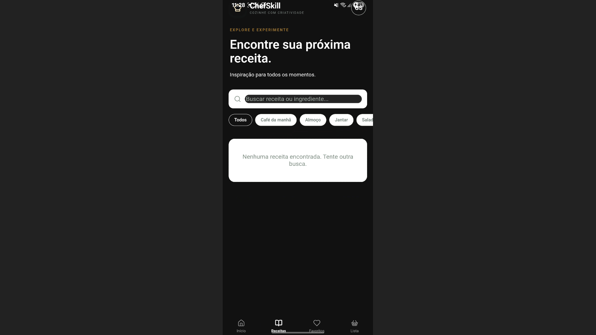
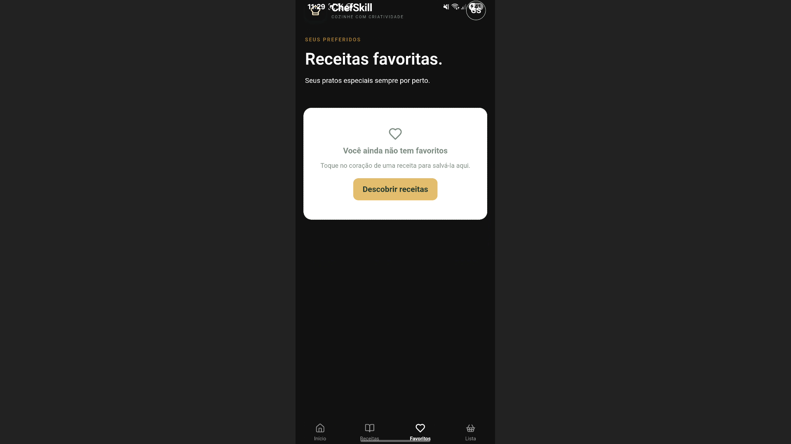
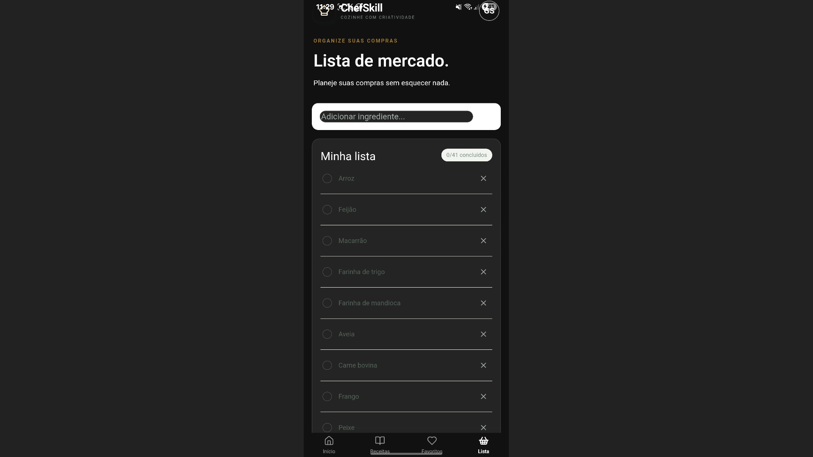
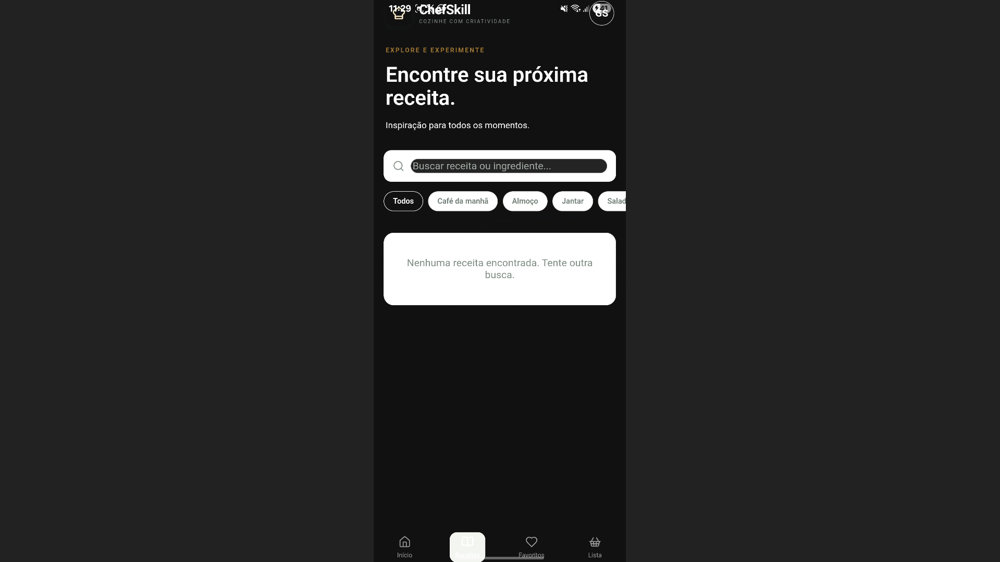
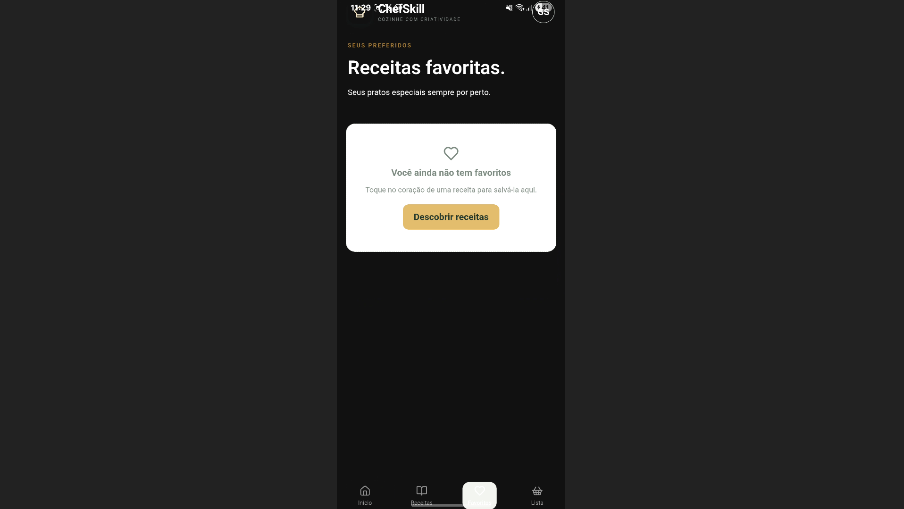
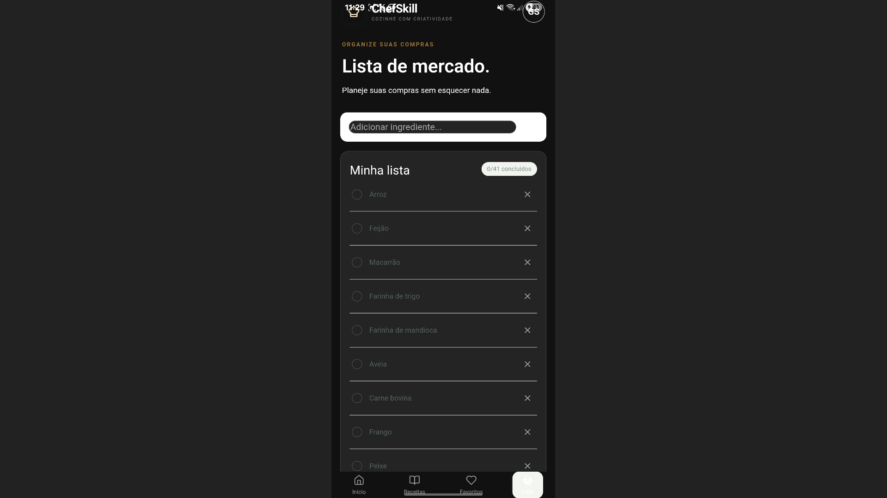

# 🍳 ChefSkill

<p align="center">
  <strong>Receitas Culinárias Passo a Passo e Lista de Mercado</strong>
</p>

<p align="center">
  Um aplicativo desenvolvido para facilitar a experiência na cozinha, permitindo descobrir receitas, acompanhar preparos e organizar ingredientes.
</p>

---

## 📱 Sobre o projeto

O **ChefSkill** é um aplicativo de culinária desenvolvido com o objetivo de tornar o preparo de receitas mais simples, organizado e acessível.

A plataforma permite explorar receitas, visualizar ingredientes, acompanhar instruções de preparo e organizar produtos em uma lista de mercado.

O projeto foi desenvolvido como parte das atividades educacionais do SENAI, envolvendo desenvolvimento mobile, identidade visual e tecnologias web.

## 🎨 Identidade visual

A identidade visual do ChefSkill foi desenvolvida com uma proposta moderna, minimalista e profissional.

| Cor | Código | Aplicação |
|---|---|---|
| ⚫ Preto | `#111111` | Cor primária |
| 🔴 Vermelho | `#D71920` | Cor secundária |
| ⚪ Branco | `#FFFFFF` | Cor terciária |

## ✨ Funcionalidades

- 🏠 **Tela inicial:** apresentação e acesso às principais funcionalidades.
- 🍽️ **Receitas:** exploração de receitas culinárias.
- 📖 **Modo de preparo:** instruções organizadas passo a passo.
- ❤️ **Favoritos:** armazenamento das receitas favoritas.
- 🛒 **Lista de mercado:** organização dos ingredientes necessários.
- 🔎 **Pesquisa:** localização de receitas.
- 📱 **Interface responsiva:** experiência adaptada para dispositivos móveis.

## 📸 Screenshots do aplicativo

### 🏠 Tela inicial


### 🍽️ Receitas



### ❤️ Favoritos



### 🛒 Lista de mercado



### Outras visualizações

<details>
<summary>Visualizar imagens alternativas</summary>

**Tela inicial alternativa**


**Receitas alternativa**



**Favoritos alternativo**



**Lista de mercado alternativa**



</details>

## 🛠️ Tecnologias utilizadas

| Tecnologia | Finalidade |
|---|---|
| React.js | Construção da interface |
| JavaScript | Lógica e funcionalidades |
| HTML5 | Estrutura da aplicação |
| CSS3 | Estilização e identidade visual |
| Vite | Ambiente de desenvolvimento e build |
| Capacitor | Integração com dispositivos móveis |
| Lucide React | Ícones da interface |
| Git e GitHub | Versionamento e hospedagem do código |

## 📂 Estrutura do projeto

```text
ChefSkill/
│
├── android/
├── assets/
├── dist/
├── docs/
├── icons/
├── img/
│   ├── favoritos1.png
│   ├── favoritos2.png
│   ├── lista1.png
│   ├── lista2.png
│   ├── receitas1.png
│   ├── recitas2.png
│   ├── tela inicial1.png
│   └── telainicial 2.png
│
├── App.jsx
├── main.jsx
├── style.css
├── index.html
├── manifest.json
├── capacitor.config.json
├── package.json
├── package-lock.json
├── vite.config.js
└── README.md
```

## 🚀 Como executar o projeto

### 1. Pré-requisitos

- Node.js instalado.
- npm instalado.
- Git instalado (opcional).

### 2. Clone o repositório

```bash
git clone https://github.com/Biel0508200817/ChefSkill.git
```

### 3. Entre na pasta

```bash
cd ChefSkill
```

### 4. Instale as dependências

```bash
npm install
```

### 5. Execute o projeto

```bash
npm run dev
```

O Vite disponibilizará um endereço local para acessar o aplicativo pelo navegador.

### 6. Gere a versão de produção

```bash
npm run build
```

Os arquivos compilados serão gerados na pasta `dist/`.

## 📲 Aplicativo Android

O ChefSkill utiliza Capacitor para integração com Android.

Para sincronizar os arquivos da aplicação com o projeto Android:

```bash
npx cap sync android
```

A geração do APK depende da configuração do ambiente Android e do processo de build utilizado no projeto.

## 🎯 Objetivo educacional

O desenvolvimento do ChefSkill permite aplicar conhecimentos de:

- Desenvolvimento de aplicações mobile.
- Construção de interfaces com React.
- Estilização com CSS.
- Organização de componentes.
- Identidade visual e branding.
- Integração com Capacitor.
- Versionamento de código com Git e GitHub.

## 👨‍💻 Desenvolvedor

**Aluno 08 — #08**

Projeto desenvolvido no contexto educacional do SENAI.

## 📌 Status do projeto

Em desenvolvimento.

---

<p align="center">
  <strong>ChefSkill — Sua cozinha, suas receitas, sua organização.</strong>
</p>

<p align="center">
  Desenvolvido com dedicação e tecnologia. ❤️
</p>
